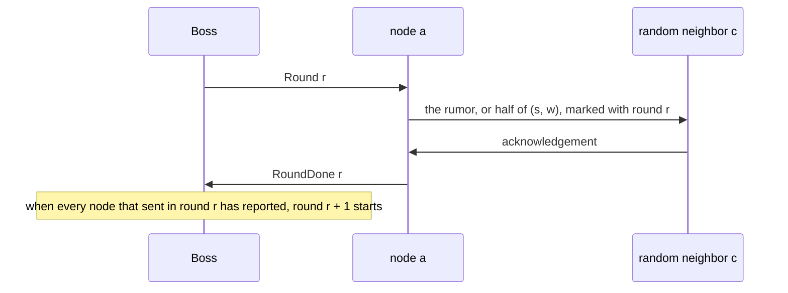
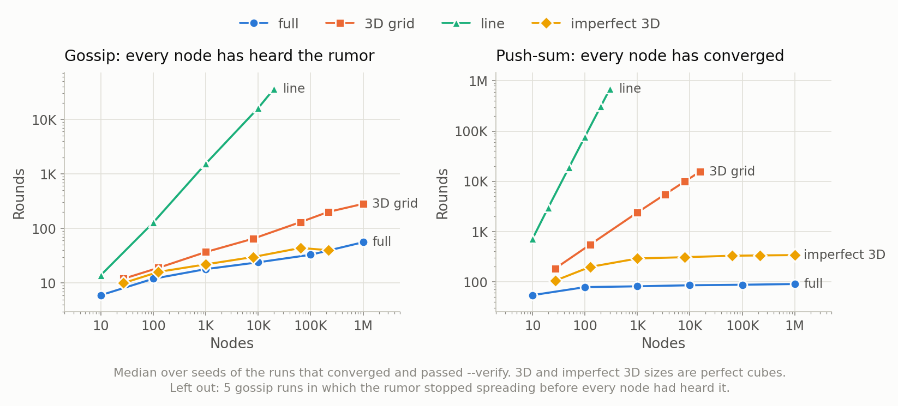

# Gossip and push-sum simulator in F# with Akka.NET

A simulator for two gossip protocols, rumor spreading and push-sum averaging, in a single F# script with one Akka.NET actor per node. The nodes form a full network, a 3D grid, a line or an imperfect 3D grid (a 3D grid plus one random neighbor per node). A boss actor runs the protocol in synchronous rounds and reports how many rounds and how much time the network took to converge. A run can be repeated exactly from its seed, and `--verify` checks the topology and the result.

This is Project 2 of COP 5615 Distributed Operating System Principles at the University of Florida (Fall 2021, Dr. Alin Dobra), submitted on October 11, 2021. It was revised in 2026.

Written by [Michael Perez](https://github.com/michaelperez023) and [Blas Kojusner](https://github.com/bkojusner).

## How it works

Everything is in [`GossipSimulator.fsx`](GossipSimulator.fsx), run with `dotnet fsi`.

### Topologies

| Topology | Neighbors of node i |
|---|---|
| `full` | every other node. No neighbor lists are stored: a node picks one of the other N − 1 nodes directly. |
| `3D` | N is rounded up to a cube k³ (with an integer cube root). Node i sits at (x, y, z) with i = x + k·y + k²·z, and its neighbors are one step away along one axis: 3 at a corner, 4 on an edge, 5 on a face and 6 inside. |
| `line` | i − 1 and i + 1, so the two ends have one neighbor each. |
| `imp3D` | the 3D grid neighbors plus one more, chosen uniformly among the nodes that are neither i nor already its neighbors. As in the assignment, the extra link goes one way. |

Every network has at least 2 nodes; `3D` and `imp3D` round 2 to 7 nodes up to 8.

### Rounds

The boss runs the protocols in synchronous rounds. In round r it sends `Round r` to every node that takes part. Each of those nodes sends its message for the round to a random neighbor, waits for the neighbor's acknowledgement and then reports `RoundDone` to the boss. When all of them have reported, every message of round r has been delivered, and the boss starts round r + 1. The rounds are kept apart by this exchange, not by timing.



Messages carry their round number, so a node that receives a message of round r before its own `Round r` keeps it apart from earlier rounds. Each node draws its random choices from its own SplitMix64 generator, seeded with the run's seed and the node's index, and the gossip start node also comes from the seed. A run with the same seed therefore gives the same rounds, messages and estimates however the threads are scheduled. The same seed gave the same results on Linux and macOS.

The convergence time is measured with `System.Diagnostics.Stopwatch` from the start of round 1 to the end of the last round. Building the topology and starting the actors are timed separately.

### Gossip

- The start node hears the rumor in round 0.
- In each round, every *active* node sends the rumor to one random neighbor. A node is active once it has heard the rumor and until it has heard it 10 times (`--rumor-limit`). It goes on counting later hearings.
- The boss sends `Round r` only to the active nodes. The acknowledgements tell it which receivers heard the rumor for the first or the 10th time.
- The run has converged when every node has heard the rumor at least once. The program reports the round, the time, the number of rumor messages, and the minimum, median and maximum number of times a node heard the rumor.

A node stops because of what it hears, not what it sends. A node whose neighbors all stop before it has heard the rumor 10 times sends until the run ends; on a line, the end nodes often do this. In the same way, a node can be cut off: every neighbor that could have told it has stopped. So the run also ends, with exit code 1, when no node that still sends has a neighbor that has not heard the rumor ("the rumor stopped spreading"), or when no node sends at all ("the rumor died out"). On large grids this does happen; see [Gossip runs that were cut off](#gossip-runs-that-were-cut-off).

### Push-sum

Push-sum is the protocol of Kempe, Dobra and Gehrke (Algorithm 1 in their [paper](#references)).

- Node i (numbered 1 to N) starts with s = i and w = 1, so the true average is (N + 1) / 2.
- In each round, every node keeps half of s and w and sends the other half to a random neighbor. Its estimate is s / w.
- Round r begins with each node adding the pairs that were sent to it in round r − 1, in the order of the senders' numbers, so that the floating-point sums do not depend on the order in which the messages arrived.
- Termination: only rounds in which a node received at least one pair count. Such a round is stable if s / w changed by at most 10⁻¹⁰ of its previous value. A node counts as converged while its last 3 counted rounds were stable, and the run ends with the first round in which every node counts as converged. Converged nodes keep sending and receiving, so the totals of s and w stay N(N + 1) / 2 and N.

These rules differ from the assignment's description on purpose:

- **Every node takes part from round 1**, as in the paper. In the assignment one actor starts, and an actor that has not received anything yet keeps the same ratio, so it can meet a "did not change in 3 rounds" rule without having taken part.
- **The threshold is relative.** The estimates are close to (N + 1) / 2. Above 2¹⁹ = 524,288, neighboring double-precision numbers are 1.16 × 10⁻¹⁰ apart, so with more than about a million nodes, a change of at most 10⁻¹⁰ in absolute terms would mean no change at all.
- **Rounds without input do not count.** A node that receives nothing halves s and w, which leaves s / w as it was and says nothing about convergence.
- **A node can stop counting as converged.** Two neighbors that swap halves in a round in which neither hears from anyone else end up with exactly the same s / w, and further exchanges between them change nothing. With a rule that held for good once met, most of the 100 nodes on a line met it in a round in which their s / w did not change at all, and the run stopped after 6,205 rounds with estimates up to 20% off. With the rule above, the same run (seed 1) took 77,368 rounds, and the largest relative error was 2.1 × 10⁻⁹.

The rule is local, so it can still be fooled on very small lines. On a line of 4 nodes, the two halves can each lock in this way for three counted rounds in a row before their values agree, and the run ends early. With seeds 1 to 500, this ended 84 runs with a largest relative error between 10⁻⁹ and 0.47, while every other run ended below 10⁻⁹. `--verify` reports the 58 of them with an error above 10⁻⁶ as failed; the other 26 pass it. With 6 nodes, 2 of 500 runs ended early in this way, one of them with an error above 10⁻⁶. With 500 seeds each on lines of 3, 5, 8, 10 or 20 nodes, on 2 × 2 × 2 and 3 × 3 × 3 grids (3D and imp3D) and on full networks of 3, 4 and 10 nodes, no run ended with an error above 1.6 × 10⁻⁹.

## Running

Requires the [.NET 10 SDK](https://dotnet.microsoft.com/download/dotnet/10.0). The first run downloads Akka.FSharp 1.5.74 from NuGet.

```
dotnet fsi GossipSimulator.fsx <numNodes> <topology> <algorithm> [--seed <n>] [--verify] [--max-rounds <n>] [--rumor-limit <n>] [--csv]
```

| Argument | Meaning |
|---|---|
| `numNodes` | number of nodes, 2 to 100,000,000; `3D` and `imp3D` round it up to the next perfect cube |
| `topology` | `full`, `3D`, `line` or `imp3D` (upper or lower case) |
| `algorithm` | `gossip` or `push-sum` |
| `--seed <n>` | seed for every random choice, from −2,147,483,648 to 2,147,483,647; without it the program picks a seed and prints it |
| `--verify` | check the topology and the result (see [Verification](#verification)) |
| `--max-rounds <n>` | stop after n rounds if the run has not converged (default below) |
| `--rumor-limit <n>` | gossip: a node stops sending once it has heard the rumor n times (default 10) |
| `--csv` | print one line of comma-separated values instead of the report; `dotnet fsi GossipSimulator.fsx --csv-header` prints the column names |

Run without arguments, the script prints its usage (`dotnet fsi` answers `--help` itself).

The exit code is 0 if the run converged (and passed `--verify`), 1 if it did not converge, a check failed or the run stopped with an error, and 2 for a usage error. An exception in an actor, such as running out of memory while starting the nodes, ends the run with the error on stderr.

With `--csv`, stdout gets exactly one line, also when the run fails; everything else, including Akka's log, goes to stderr. The `status` column is `converged`, `died-out`, `cut-off` (see [Gossip](#gossip)), `max-rounds`, `error`, or `topology-failed` when `--verify` rejects the topology before the run.

The default for `--max-rounds` grows with the network:

| | gossip | push-sum |
|---|---|---|
| `full`, `imp3D` | 1000 + 50·⌈log₂ N⌉ | 1000 + 50·⌈log₂ N⌉ |
| `3D`, `line` | 100 + 10·D | 1000 + 50·D² |

D is the diameter: N − 1 for a line and 3(k − 1) for a k × k × k grid. The limits are only meant to stop runs that would not converge. Gossip on a full network needs the most room for its size: near the end, the last nodes that have not heard the rumor can only be told by the few nodes that still send it, and each of those picks among all N nodes. With 1,000,000 nodes, seeds 1, 3 and 4 took 54 to 56 rounds, seed 2 took 163 and seed 5 took 323.

`dotnet fsi` uses server garbage collection, because its runtime configuration sets `System.GC.Server`. That matters for large runs: on the 24-thread desktop used for the results, the million-node gossip run on the full network (seed 1) took 13 s to start its actors and 23 s to converge; with workstation garbage collection (`DOTNET_gcServer=0`), it took 23 s and 50 to 52 s. The million-node runs needed 3.9 to 4.6 GB of memory at their peak, so the largest network that can be simulated depends on the memory available.

Examples, run on that desktop:

```
$ dotnet fsi GossipSimulator.fsx 1000 imp3D push-sum --seed 1 --verify
Push-sum on an imperfect 3D grid (10 x 10 x 10, plus one random neighbor per node): 1000 nodes, seed 1
At most 1500 rounds
Topology built in 1.9 ms (6400 links)
Verify topology: OK: nodes by number of neighbors: 8 with 4, 96 with 5, 384 with 6, 512 with 7; no self links or duplicates; grid links join adjacent nodes and go both ways, extra links are new neighbors; connected; every node picks among its neighbors
1000 actors started in 21.4 ms
Convergence time: 719.0 ms
Rounds: 291
Messages sent: 291000
Converged nodes: 1000 of 1000
True average (N + 1) / 2: 500.5
Estimates: min 500.49999996923214, max 500.5000000215425, max relative error 6.15e-11
Verify push-sum: OK: all 1000 nodes converged; total w = 1000.0000000000015 (relative error 1.48e-15); total s = 500500.0000000002 (relative error 3.49e-16); max relative error 6.15e-11 <= 1e-6
```

```
$ dotnet fsi GossipSimulator.fsx 1000000 full gossip --seed 1 --verify
Gossip on a full network: 1000000 nodes, seed 1
Start node 386242, rumor limit 10, at most 2000 rounds
Topology built in 0.2 ms
Verify topology: OK: every node picks among the other 999999 nodes (each pick checked for nodes 0, 500000 and 999999)
1000000 actors started in 13135.7 ms
Convergence time: 22624.8 ms
Rounds: 56
Messages sent: 14641892
Coverage: 1000000 of 1000000 nodes heard the rumor
Hearings per node: min 1, median 14, max 37
Verify gossip: OK: all 1000000 nodes heard the rumor; messages sent = hearings - 1 (the start node's): 14641892 = 14641893 - 1; every node sent once in each round that it started having heard the rumor 1 to 9 times, and in no other round
```

A gossip run in which one node was cut off (exit code 1):

```
$ dotnet fsi GossipSimulator.fsx 216000 3D gossip --seed 1
Gossip on a 3D grid (60 x 60 x 60): 216000 nodes, seed 1
Start node 138242, rumor limit 10, at most 1870 rounds
Topology built in 49.1 ms (1274400 links)
216000 actors started in 3894.9 ms
The rumor stopped spreading after round 202: the 37304 nodes still sending have no neighbor left to tell
Time: 8304.5 ms, without converging
Rounds: 202
Messages sent: 5727910
Coverage: 215999 of 216000 nodes heard the rumor
Hearings per node: min 0, median 23, max 166
```

"Messages sent" counts the rumors or (s, w) pairs sent between nodes, not the acknowledgements or the boss's messages.

### Benchmarks

[`scripts/benchmark.sh`](scripts/benchmark.sh) runs every topology and algorithm over a range of sizes and seeds (listed at the top of the script) with `--verify --csv`, and adds one line per run to `results/results.csv`. Runs that are already in the file are skipped, so a sweep that was interrupted continues when the script is started again. The script runs `dotnet` unless the `DOTNET` environment variable names another executable. Where the `timeout` command exists (as on Linux), each run is stopped after `RUN_TIMEOUT` seconds (default 3600). A run that prints no CSV line is recorded with status `timeout` or `crashed`.

[`scripts/plot.py`](scripts/plot.py) draws `docs/convergence.png` from that file: rounds against nodes on log-log axes, one line per topology, the median over seeds of the runs that converged and passed `--verify`. It lists the runs it leaves out on stderr, and the note under the figure gives the number of gossip runs in which the rumor stopped spreading.

```
scripts/benchmark.sh
python3 scripts/plot.py      # needs matplotlib; or: uv run --no-project --with matplotlib python scripts/plot.py
```

## Verification

`--verify` checks the topology before the run:

- every node has the expected number of neighbors: 1 at the ends of a line and 2 elsewhere; 3, 4, 5 or 6 for a corner, edge, face or inner node of a 3D grid; one more in `imp3D`;
- no node is its own neighbor or has the same neighbor twice;
- grid links join adjacent nodes and go both ways (the extra `imp3D` links go one way);
- every node can be reached from node 0;
- the random pick that the simulation uses ranges over exactly the node's neighbors: it draws one of as many numbers as the node has neighbors, and each number gives a different neighbor. In a full network, every node draws one of N − 1 numbers; all of them are checked for nodes 0, N/2 and N − 1, and the lowest and highest for the other nodes.

After the run it checks the result:

- **gossip:** every node heard the rumor; the number of rumors sent equals the number of hearings minus the start node's; and, by each node's own count, every node sent exactly once in each round that it began having heard the rumor 1 to 9 times, and in no other round;
- **push-sum:** every node counts as converged; the totals of w and s are N and N(N + 1) / 2 within a relative 10⁻⁹; and every estimate is within a relative 10⁻⁶ of (N + 1) / 2.

A failed check exits with code 1.

## Results

[`scripts/benchmark.sh`](scripts/benchmark.sh) ran gossip and push-sum on every topology at the sizes listed at the top of the script, each with seeds 1, 2 and 3 and `--verify`: 150 runs, which took 1 hour 53 minutes. The machine was an otherwise idle desktop with an AMD Ryzen Threadripper 1920X (12 cores, 24 threads) and 31 GiB of RAM, running Ubuntu 24.04.5 with .NET SDK 10.0.404 and Akka.FSharp 1.5.74. Each run is a line of [`results/results.csv`](results/results.csv). All 75 push-sum runs and 70 of the 75 gossip runs converged and passed `--verify`; in the other 5, the rumor stopped spreading before every node had heard it (see [below](#gossip-runs-that-were-cut-off)). No run reached its round limit; the closest, gossip on a line of 20,000 nodes with seed 3, used 39,377 of the 200,090 rounds it was allowed.



Rounds and times below are medians over the seeds.

- **Full network and imperfect 3D grid.** The rounds grow slowly with N. On the full network, gossip took 6 rounds with 10 nodes and 6 to 9 more for each tenfold increase up to 100,000 nodes (33 rounds); with a million nodes, two runs took 55 and 56 rounds and the third took 163. Push-sum took 78 rounds with 100 nodes and 90 with a million. On the imperfect 3D grid, gossip took 10 to 44 rounds from 27 to 216,000 nodes, and push-sum 290 rounds with 1,000 nodes and 339 with a million.
- **3D grid.** The rounds depend on the side k of the cube. Doubling it from 20 to 40 (8,000 to 64,000 nodes) doubled the gossip rounds, from 65 to 131, and from 8,000 nodes up the gossip rounds were 0.95 to 1.14 times the grid's diameter 3(k − 1). Push-sum grows with k²: doubling the side from 10 to 20 (1,000 to 8,000 nodes) multiplied its rounds by 4.1, from 2,392 to 9,919. The one random neighbor per node of the imperfect grid makes a large difference: with 1,000 nodes, gossip took 22 rounds on the imperfect grid and 37 on the plain one, and push-sum 290 and 2,392.
- **Line.** The slowest topology for both algorithms. Gossip took 1.29 to 1.82 rounds per node: 36,335 rounds and 144.9 s for 20,000 nodes. Push-sum grows with N²: doubling the line from 100 to 200 nodes multiplied its rounds by 4.0, from 77,368 to 310,293, and 300 nodes took 694,938 rounds and 298.2 s. Gossip on a line also sent the most messages, 5,427 per node with 20,000 nodes against 14.6 on the full network of a million: a node whose neighbors have both stopped before it has heard the rumor 10 times sends until the run ends (see [Gossip](#gossip)).
- **Push-sum against gossip.** Push-sum needs far more rounds on the same network: with 1,000 nodes, 81 against 18 on the full network, 290 against 22 on the imperfect 3D grid and 2,392 against 37 on the 3D grid, and on a line of 100 nodes, 77,368 against 129. Gossip ends when every node has heard the rumor once, push-sum only when every estimate has stopped changing (see [Push-sum](#push-sum)). On the full network, push-sum took 9 times as many rounds as gossip with 10 nodes and 1.6 times as many with a million (90 against 56), and the ratio fell steadily in between. The largest relative error of any push-sum estimate was 4.9 × 10⁻⁹, on the line of 300 nodes.
- **Largest networks.** Both algorithms ran on a million nodes on the full network and the imperfect 3D grid (where all three gossip runs were cut off), and gossip also ran on the 100 × 100 × 100 grid. Push-sum on the 3D grid (up to 15,625 nodes) and both algorithms on the line were run on smaller networks, since they need many more rounds. The longest runs were push-sum on the imperfect 3D grid of a million nodes: 339 rounds in 486.7 s. Starting the actors is not part of these times; for a million nodes it took 11.8 to 13.2 s.

### Gossip runs that were cut off

In 5 gossip runs, the rumor stopped spreading while 1 to 3 nodes had not heard it, because every neighbor that could have told them had heard it 10 times and stopped sending (see [Gossip](#gossip)). These runs exited with code 1 and failed `--verify`, and the figure and the tables leave them out.

| Topology | Nodes | Seed | Stopped after round | Nodes that heard the rumor |
|---|---:|---:|---:|---:|
| `3D` | 216,000 | 1 | 202 | 215,999 |
| `3D` | 1,000,000 | 3 | 385 | 999,999 |
| `imp3D` | 1,000,000 | 1 | 62 | 999,998 |
| `imp3D` | 1,000,000 | 2 | 88 | 999,999 |
| `imp3D` | 1,000,000 | 3 | 46 | 999,997 |

This happened only on the grids of 216,000 and 1,000,000 nodes, in 5 of their 12 gossip runs, among them all three on the imperfect 3D grid of a million nodes, which therefore has no gossip result. With a rumor limit of 10, gossip on a large grid does not always reach every node, although no run missed more than 3 nodes. Push-sum runs cannot be cut off, since converged nodes keep sending.

### Rounds, times and messages

Medians over seeds 1, 2 and 3, with the range of the rounds in parentheses; where a run was cut off, the median is over the other two, which makes it their mean. The convergence time runs from the start of round 1 to the end of the last round (see [Rounds](#rounds)). Messages are the rumors or (s, w) pairs sent between nodes; in push-sum every node sends one pair per round, so they are N times the rounds.

**Gossip**

| Topology | Nodes | Rounds | Convergence time | Messages |
|---|---:|---:|---:|---:|
| `full` | 10 | 6 (4–6) | 2.2 ms | 26 |
| | 100 | 12 (10–15) | 4.5 ms | 527 |
| | 1,000 | 18 (18–19) | 29.1 ms | 7,666 |
| | 10,000 | 24 (24–32) | 317.2 ms | 94,969 |
| | 100,000 | 33 (30–34) | 1.9 s | 1,173,170 |
| | 1,000,000 | 56 (55–163) | 23.3 s | 14,641,892 |
| `3D` | 27 | 12 (8–13) | 2.7 ms | 150 |
| | 125 | 19 (18–20) | 6.5 ms | 963 |
| | 1,000 | 37 (35–38) | 34.9 ms | 10,970 |
| | 8,000 | 65 (62–68) | 348.0 ms | 115,338 |
| | 64,000 | 131 (123–132) | 2.2 s | 1,322,675 |
| | 216,000 | 201 (175–227), seed 1 cut off | 8.9 s | 5,833,857 |
| | 1,000,000 | 282.5 (263–302), seed 3 cut off | 52.2 s | 34,017,343.5 |
| `line` | 10 | 14 (11–16) | 2.4 ms | 60 |
| | 100 | 129 (115–187) | 15.5 ms | 2,703 |
| | 1,000 | 1,545 (958–1,751) | 713.7 ms | 244,553 |
| | 10,000 | 16,135 (12,414–19,103) | 34.5 s | 25,504,953 |
| | 20,000 | 36,335 (27,511–39,377) | 144.9 s | 108,533,497 |
| `imp3D` | 27 | 10 (9–13) | 2.7 ms | 122 |
| | 125 | 16 (15–16) | 6.6 ms | 820 |
| | 1,000 | 22 (20–23) | 29.3 ms | 7,856 |
| | 8,000 | 30 (28–38) | 265.3 ms | 83,837 |
| | 64,000 | 44 (36–51) | 1.6 s | 857,002 |
| | 216,000 | 40 (38–41) | 4.2 s | 2,538,690 |
| | 1,000,000 | all 3 runs cut off | | |

**Push-sum**

| Topology | Nodes | Rounds | Convergence time | Messages |
|---|---:|---:|---:|---:|
| `full` | 10 | 54 (54–59) | 7.6 ms | 540 |
| | 100 | 78 (78–79) | 29.0 ms | 7,800 |
| | 1,000 | 81 (81–82) | 216.1 ms | 81,000 |
| | 10,000 | 85 (83–85) | 1.8 s | 850,000 |
| | 100,000 | 87 (87–87) | 11.8 s | 8,700,000 |
| | 1,000,000 | 90 (90–93) | 131.2 s | 90,000,000 |
| `3D` | 27 | 183 (168–187) | 23.5 ms | 4,941 |
| | 125 | 547 (535–550) | 172.0 ms | 68,375 |
| | 1,000 | 2,392 (2,373–2,403) | 3.6 s | 2,392,000 |
| | 3,375 | 5,509 (5,484–5,569) | 24.8 s | 18,592,875 |
| | 8,000 | 9,919 (9,893–9,941) | 102.1 s | 79,352,000 |
| | 15,625 | 15,567 (15,561–15,618) | 309.7 s | 243,234,375 |
| `line` | 10 | 716 (690–726) | 33.0 ms | 7,160 |
| | 20 | 3,016 (3,008–3,065) | 222.7 ms | 60,320 |
| | 50 | 19,152 (18,578–19,845) | 1.7 s | 957,600 |
| | 100 | 77,368 (76,186–77,429) | 11.3 s | 7,736,800 |
| | 200 | 310,293 (307,223–310,358) | 88.7 s | 62,058,600 |
| | 300 | 694,938 (691,053–696,620) | 298.2 s | 208,481,400 |
| `imp3D` | 27 | 105 (103–112) | 16.2 ms | 2,835 |
| | 125 | 197 (195–202) | 76.2 ms | 24,625 |
| | 1,000 | 290 (259–291) | 778.0 ms | 290,000 |
| | 8,000 | 308 (306–315) | 3.5 s | 2,464,000 |
| | 64,000 | 329 (327–331) | 27.4 s | 21,056,000 |
| | 216,000 | 334 (331–334) | 95.6 s | 72,144,000 |
| | 1,000,000 | 339 (338–340) | 486.7 s | 339,000,000 |

## Continuous integration

[`.github/workflows/ci.yml`](.github/workflows/ci.yml) runs on every push and pull request. It runs `--verify` for every topology with both algorithms, on 2 nodes and on 1,000 nodes (50 for push-sum on a line), checks that two runs with the same seed print the same rounds, messages and estimates, that `--csv` prints a single line with every column, and that an unknown topology exits with code 2.

## References

- David Kempe, Alin Dobra and Johannes Gehrke. "Gossip-Based Computation of Aggregate Information." 44th Annual IEEE Symposium on Foundations of Computer Science (FOCS 2003), pages 482–491. [PDF (authors' copy)](https://www.cs.cornell.edu/johannes/papers/2003/focs2003-gossip.pdf), [doi:10.1109/SFCS.2003.1238221](https://doi.org/10.1109/SFCS.2003.1238221).
- Guy L. Steele Jr., Doug Lea and Christine H. Flood. "Fast Splittable Pseudorandom Number Generators." OOPSLA 2014, pages 453–472. [doi:10.1145/2660193.2660195](https://doi.org/10.1145/2660193.2660195). The SplitMix64 generator used for every random choice.
